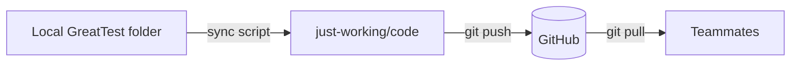

# just-working

A shared mirror of the **GreatTest** codebase, used to keep teammates' copies of the project in sync.

GreatTest is an evidence-based adaptive testing framework for conversational AI agents (final year project). It statically analyzes an agent's repository to build a behavioral model, tests the running agent with persona-driven dialogue, and reconciles what the code claims against what the agent actually does.

## What's in this repo

| Path | Purpose |
|------|---------|
| `code/` | Mirrored copy of the GreatTest project. Its own `README.md` and `docs/` describe the framework in detail |
| `sync.bat` | Windows script that mirrors the local GreatTest folder into `code/` (skips `.git`, `.venv`, `__pycache__` and `.env`) |
| `syncEman.bat` | Same sync for a teammate's Windows machine |
| `syncAliza.sh` | Same sync for a teammate's Linux machine |

## How the sync works

Run the sync script that matches your machine, then commit and push. The scripts hard-code each person's local paths, so edit the source path at the top before first use.

## Notes

- `code/` is overwritten on every sync. Make changes in the GreatTest source folder, not here.
- `.env` files are excluded from the mirror on purpose. Copy `code/.env.example` and fill in your own keys.
